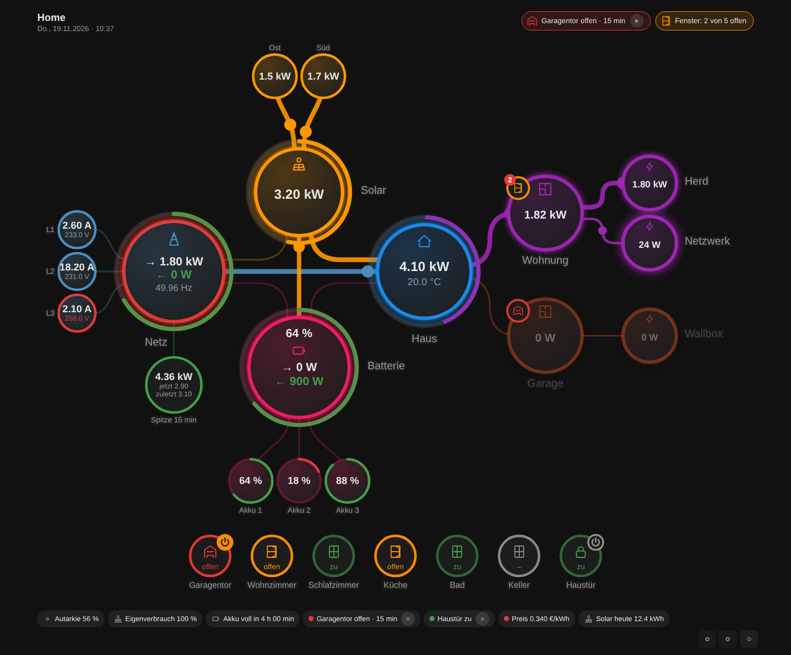

# Flow Card (W / A / V)

A Home Assistant dashboard card in the style of the Energy distribution card, but with **power (W), current (A) and voltage (V)** on every circle.



*Screenshot rendered with test data.*


[](https://www.buymeacoffee.com/YOUR_NAME)


## Features

- Grid, solar, battery, house, zones and devices as circles with animated flow dots
- Power, current, voltage, temperature, state of charge, frequency, phases (L1/L2/L3)
- 15-minute peak (Spitze) and meter readings (import/export)
- Several batteries and several solar strings as small child circles
- Horizontal and vertical layout, fullscreen button, zoom and pan
- Title, date and time sensors
- Status of garage door, windows, doors and locks (header pills, info line, badge on a circle, independent circles at the bottom), warning after a configurable time
- Switch button per device circle and per status entry (toggle lights, open/close the garage door, lock/unlock)
- Status entries can also be smoke/gas/CO/water detectors, motion, presence, lights, switches, temperatures, humidity or **any sensor** (with warn/alert thresholds or text states)
- **Looks**: design themes, 15 backgrounds (custom colour, gradient or image), animated backgrounds (drifting colours, twinkling stars), automatic day/night background, weather background (rain, snow, clouds, fog, lightning, sun), circle styles (flat, glass, neon), circle shapes (circle, square, hexagon) and size, compact mode, sparklines, line styles (dashed, dotted, flowing, neon), arrow/diamond markers and smoothly counting numbers
- Calm mode (dimmed display at night), limit colours, gradients, glow and pulse effects - each option can be switched off
- Visual editor (every option) and YAML

## Installation

### HACS (recommended)

1. HACS → three dots → **Custom repositories**
2. Repository: `https://github.com/xFirefliesx/flow-card-vaw`, category **Dashboard**
3. Download **Flow Card (W / A / V)**, then reload the browser.

HACS adds the resource automatically. If you use YAML dashboards, add it yourself:

```yaml
resources:
  - url: /hacsfiles/flow-card-vaw/flow-card-vaw.js
    type: module
```

### Manual

1. Copy `flow-card-vaw.js` to `/config/www/`.
2. Settings → Dashboards → Resources → add `/local/flow-card-vaw.js` as **JavaScript module** (add `?v=2`, `?v=3` ... after updates to bypass the browser cache).

## Minimal configuration

```yaml
type: custom:flow-card-vaw
grid:
  power: sensor.grid_power        # positive = import, negative = export
  current: sensor.grid_current
  voltage: sensor.grid_voltage
solar:
  power: sensor.pv_power
battery:
  power: sensor.battery_power     # positive = discharging
  soc: sensor.battery_soc
home:
  power: sensor.house_power
```

Almost everything can be set in the visual editor. All options with comments are documented in [CONFIGURATION.md](CONFIGURATION.md) (in German).

### Status entries (garage door, windows, locks)

```yaml
status:
  - name: Garage door
    entity: cover.garage
    kind: garage
    show: [header, info, circles]
    warn_after: 600        # seconds open before it turns red and blinks
    switch: true           # small button to open/close
  - name: Front door
    entity: lock.front_door
    kind: lock
    show: [info, circles]
    switch: true
    switch_confirm: true   # ask before locking/unlocking
```

Smoke detectors, temperatures and any other entity work the same way:

```yaml
status:
  - name: Smoke detectors
    entities: [binary_sensor.smoke_hall, binary_sensor.smoke_kitchen]
    show: [header, circles]
  - name: Living room
    entity: sensor.living_room_temperature
    warn_above: 25
    alert_above: 30
  - name: Heating
    entity: sensor.heating_state
    kind: sensor
    warn_states: [heating]
    icon: mdi:radiator
```


State texts such as `on/off`, `open/closed`, `opening/closing`, `locked/unlocked` and German texts (`geöffnet`, `geschlossen`, `öffnet`, `schließt`) are recognised. Use `open_states` / `closed_states` for your own texts.

### Looks (all optional)

```yaml
theme: hex_tech              # neon_night | glass_aurora | minimal_light | hex_tech | cozy_sunset | ocean_calm | blueprint
background: midnight         # default | transparent | dark | black | light | midnight | aurora | sunset | ocean | forest | grid | dots | color | gradient | image
background_animation: stars  # none | drift | stars
background_night: black      # background used at night (sun.sun below horizon, or background_night_entity: ...)
background_weather: weather.home   # rain, snow, clouds, fog, lightning, sun behind the card
circle_style: neon           # default | flat | glass | neon
node_shape: hexagon          # circle | square | hexagon
node_size: 1.1               # 0.6 - 1.4 (single circle: size: 1.2 on grid/solar/battery/home/device)
compact: auto                # off | auto (narrow card) | on
sparkline: true              # mini history curve behind the values
sparkline_hours: 6           # 1 - 48
line_style: flow             # solid | dashed | dotted | flow | neon
flow_marker: arrow           # dot | arrow | diamond
number_animation: true       # numbers count smoothly to the new value
```

Settings you write yourself always override a theme. Animations are paused in calm mode and disabled if the device asks for reduced motion.


### Zoom

Ctrl + mouse wheel (mouse wheel alone in fullscreen), pinch on touch screens, drag to pan, or use the + / − buttons at the bottom right. In fullscreen the zoomed card fills the whole screen. Disable with `zoom: false`, limit with `zoom_max: 4`.

## Troubleshooting

- **Card not found / old version after update**: reload the browser with Ctrl+Shift+R or clear the app's frontend cache. The card version is shown at the top of the visual editor.
- **Switch buttons do nothing**: the entity must be controllable (`switch`, `light`, `cover`, `lock`, `button`, `scene`, `script`, ...) and available.

## Deutsch

Eine Energiefluss-Karte für Home Assistant mit Leistung (W), Strom (A) und Spannung (V) an jedem Kreis. Neu in 1.1.1: kleine Kreise einzeln verschiebbar, Raster und Hilfslinien, Durchmesser und Schriftgröße pro Kreis, Sammelkreis „Rest", sortierter Editor. Neu in 1.1.0: Ansichten (Tabs), Layout-Assistent, Zeitreise, Zonen-Rahmen, eigene Icons, Wert-Labels an Linien, CO₂-Chip und Partikel-Marker; außerdem werden alle Werte aus der Konfiguration jetzt maskiert (Sicherheit). Davor: Design-Vorlagen, Hintergründe, Kreisformen, Sparklines, Linienstile und erweiterte Status-Anzeigen. Installation über HACS als benutzerdefiniertes Repository (Kategorie *Dashboard*) oder manuell (siehe oben). Die vollständige, kommentierte Konfiguration steht in [CONFIGURATION.md](CONFIGURATION.md); fast alles lässt sich im visuellen Editor einstellen.

## License

MIT
